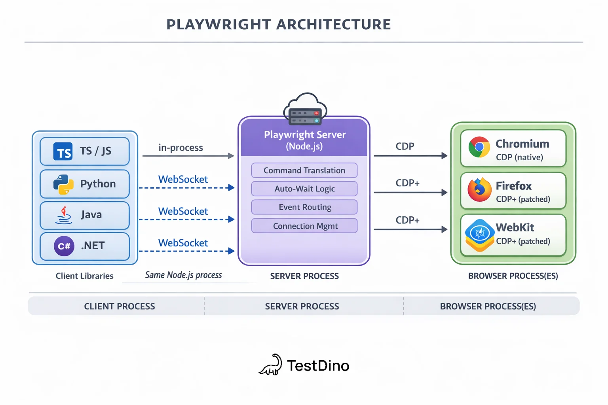

# Playwright

## Kiến trúc

Kiến trúc Playwright gồm 3 tầng:
- **Thư viện client:** Là test script do người dùng viết, thực hiện biên soạn câu lệnh thành tin nhắn JSON để gửi đến Playwright Server. 
- **Playwright Server:** Là 1 tiến trình Node.js, chịu trách nhiệm nhận tin nhắn từ client và điều phối các browser để thực hiện test.
- **Browser:** Là trình duyệt thực thi các tác vụ test: click, điền field, tải trang,... và báo kết quả, sự kiện ngược về server.


## Nguyên lý hoạt động

**Vòng đời 1 test**
1. Runner khởi động worker, worker launch trình duyệt
2. Mỗi test nhận một BrowserContext + Page mới
3. Script gọi API → client gửi lệnh JSON → server dịch sang giao thức trình duyệt → trình duyệt thực thi, trả kết quả/sự kiện về.
4. Test kết thúc → đóng context, thu trace/screenshot/video nếu cấu hình yêu cầu.

**Giao tiếp giữa các tầng**
- Thư viện client chạy chung 1 tiến trình với server nếu được viết bằng JaveScript/TypeScript, giao tiếp với server thông qua WebSocket nếu được viết bằng các ngôn ngữ khác (Python / C# / Java)
- Giao tiếp giữa server với browsers:
    + Chromium giao tiếp với server bằng CDP (Chrome DevTools Protocol)
    + Firefox và WebKit dùng giao thức riêng của Playwright

**Cơ chế tìm phần tử bằng Locator**
Locator không tìm sẵn phần tử mà là công thức để tìm kiếm phần tử, được phân giải mỗi lần thực hiện.
Các locator thường dùng:
```TypeScript
//Tìm phần tử theo vai trò trên trang
page.getByRole('button', { name: 'Đăng nhập' }) 

//Tìm phần tử theo nhãn
page.getByLabel('Mật khẩu') 

//Tìm phần tử theo text
page.getByText('Quên mật khẩu') 

//Tìm theo id của phần tử
page.getByTestId('submit')  

//Tìm theo thuộc tính của phần tử
page.locator('css=... >> text=...') 

//Lấy 1 phần tử khi locator trả ra tập nhiều phần tử -> Sử dụng .nth()
page.getByRole('button').nth(0)
```
*Nên ưu tiên sử dụng các locator theo hướng người dùng: getByRole, getByLabel, getByText.*

# WebdriverIO

## Kiến trúc

## Nguyên lý hoạt động

# Tham khảo
- https://testdino.com/blog/playwright-architecture