**Các bug sau đã được báo cáo trên tab Issues thuộc repo của nhóm trên GitHub**
Link tab Issues: https://github.com/naaul1/eshop-sut-2627/issues

**[ER-FR03-01]** *Chương trình sinh và nhận mã OTP gồm 4 chữ số thay vì 6.*
- Screenshot: 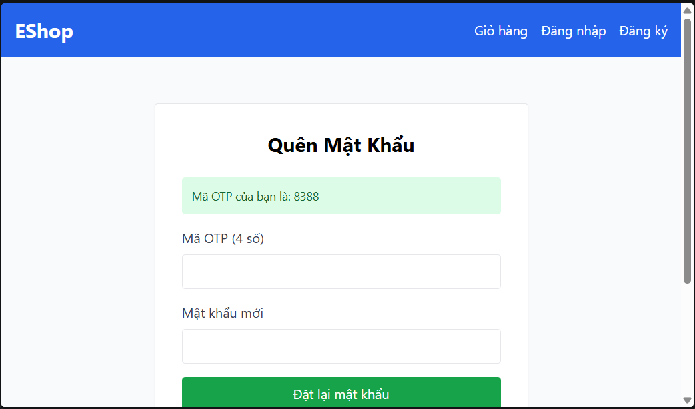

**[ER-FR03-02]** *Chương trình chấp nhận sai điều kiện mật khẩu mới.*
Mật khẩu dùng để test:
- NewPass1! -> rejected
Screenshot: 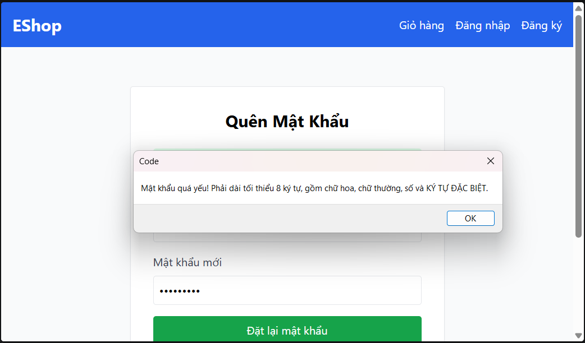
- New Pass12 -> accepted 
Screenshot: 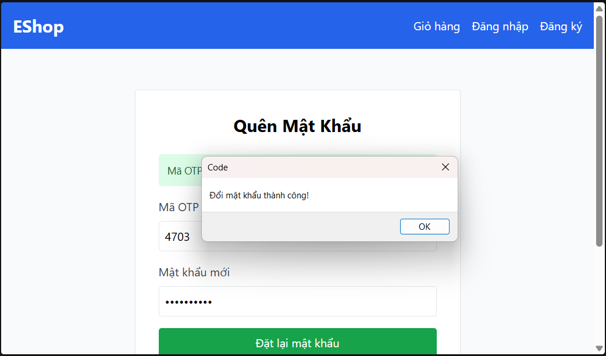

Điều kiện kiểm tra thực tế trong chương trình:
- Tối thiểu 8 ký tự
- Có ít nhất 1 chữ thường và 1 chữ hoa
- Có ít nhất 1 số
- Có ít nhất 1 khoảng trắng
- Không có ý tự đặc biệt ngoài chữ hoa, chữ thường, số và khoảng trắng

**[ER-FR03-03]** *Giao diện không có nút Quay lại đăng nhập và chỉ báo số bước.*
Screenshot: 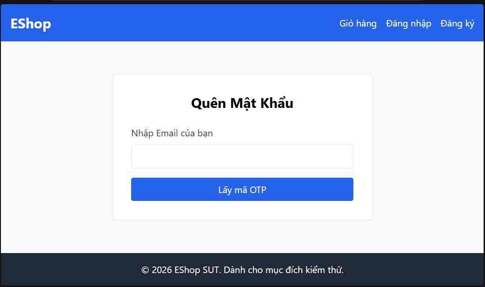

**[ER-FR03-04]** *Giao diện đổi mật khẩu thiếu trường Xác nhận mật khẩu mới*
Screenshot: 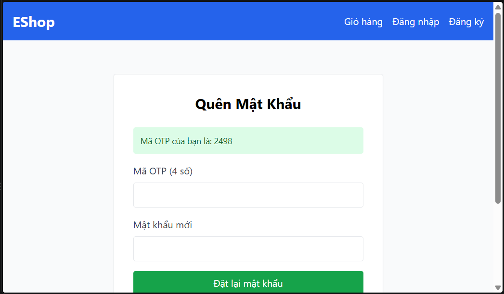

**[ER-FR09-01]** *Áp dụng sai công thức giảm giá*
Chi tiết lỗi:
- Dữ liệu đầu vào:
{
    "code": "SAVE10",
    "total_amount": "30000000"
}
(áp dụng giảm giá 10% cho đơn 30.000.000 đ)
- Dữ liệu đầu ra:
{
    "discount_amount": -270000000, 
    "final_amount": 300000000
}
(giá tiền sau giảm giá là 300.000.000 đ)
- Mô tả lỗi: Chương trình áp dụng sai công thức giảm giá theo phần trăm
Screenshot: 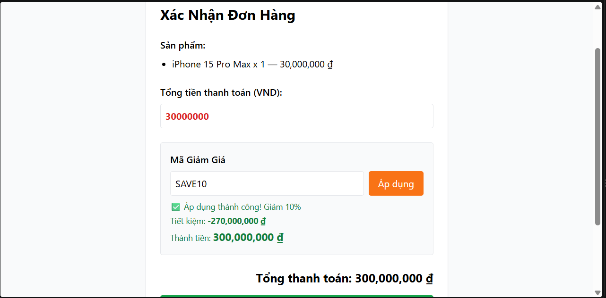

**[ER-FR09-02]** *Chương trình không kiểm tra người dùng đã đăng nhập và có JWT hợp lệ khi áp dụng coupon*
Screenshot: 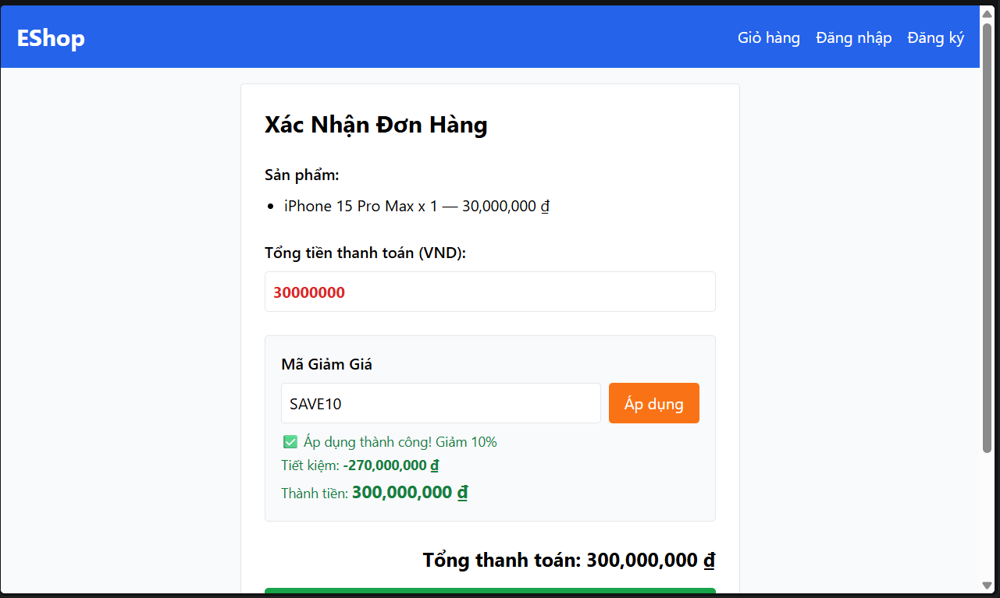

**[ER-FR09-03]** *Coupon bị từ chối áp dụng tại đúng ngưỡng min của giá đơn hàng*
Screenshot: 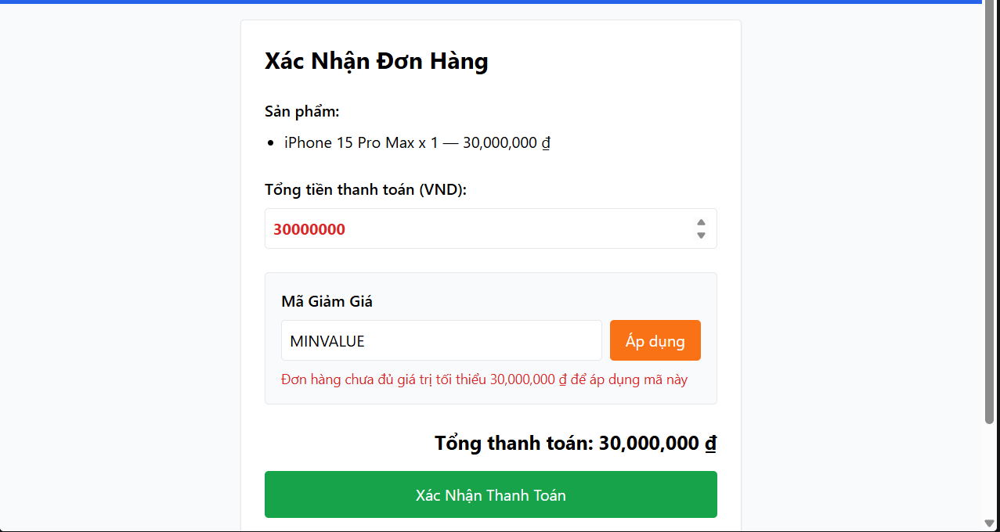

**[ER-FR17-01]** *`discount_value` nhận giá trị 0 hoặc âm*
Screenshot: 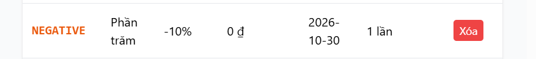

**[ER-FR17-02]** *`min_order_amount` nhận giá trị âm hoặc rỗng*
- Khi nhận giá trị âm: UI hiển thị giá trị âm
- Khi nhận giá trị rỗng: UI hiển thị giá trị rỗng
Screenshot: 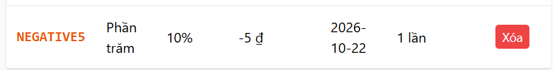 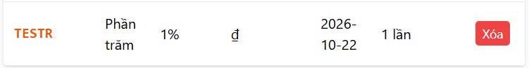

**[ER-FR17-03]** *`max_uses_per_user` nhận giá trị rỗng*
- Khi nhận giá trị rỗng, UI hiển thì giới hạn sử dụng là 1
Screenshot:
- Giá trị nhập vào: 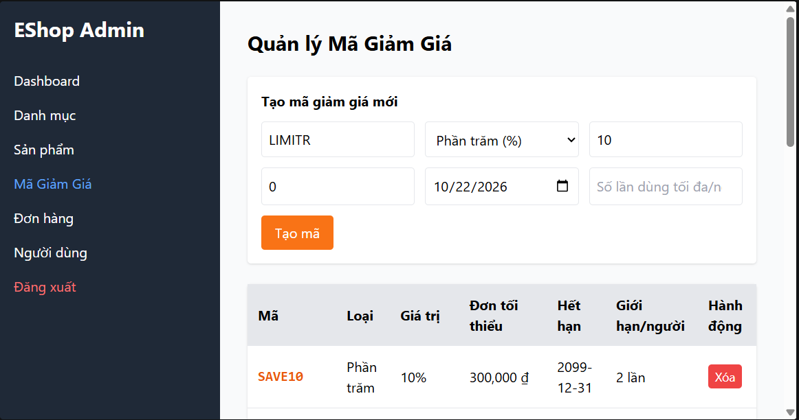
- Giá trị hiển thị: 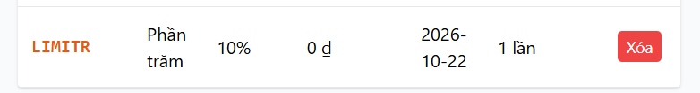

**[ER-FR20-01]** *OTP không hiển thị trên môi trường demo*
Screenshot: 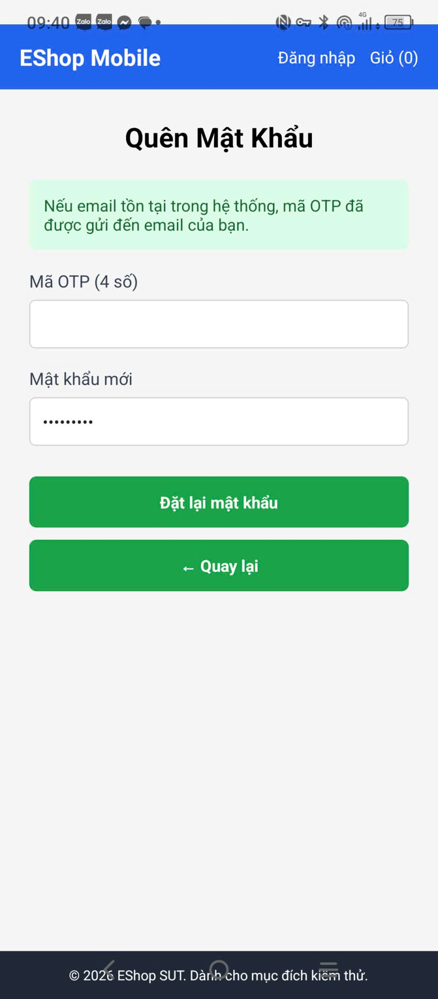

**[ER-FR20-02]** *Kiểm tra sai điều kiện mật khẩu*
Tương tự ER-FR03-02

**[ER-FR20-03]** *Không có trường Xác nhận mật khẩu mới*
Screenshot: 

**[ER-FR20-04]** *Không có chỉ báo số bước, không có nút Quay về đăng nhập*
Screenshot: 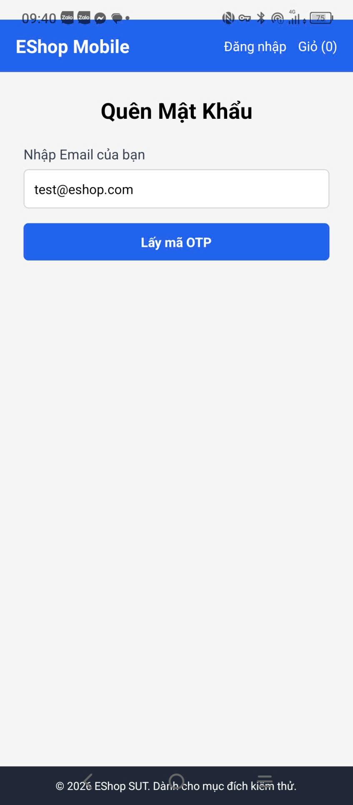