**Các lỗi đã tìm được:**

*ER-UI-01*: Luồng đăng nhập hiển thị "Đăng ký"

*ER-UI-06*: Màn hình Quên mật khẩu bước 2 có nút Đặt lại mật khẩu và nút Quay lại có hiển thị giống nhau

*ER-UI-11*: Form đăng nhập hiển thị "Username" thay vì "Email"

*ER-UI-13*: Màn hình quên mật khẩu không có chỉ báo số bước
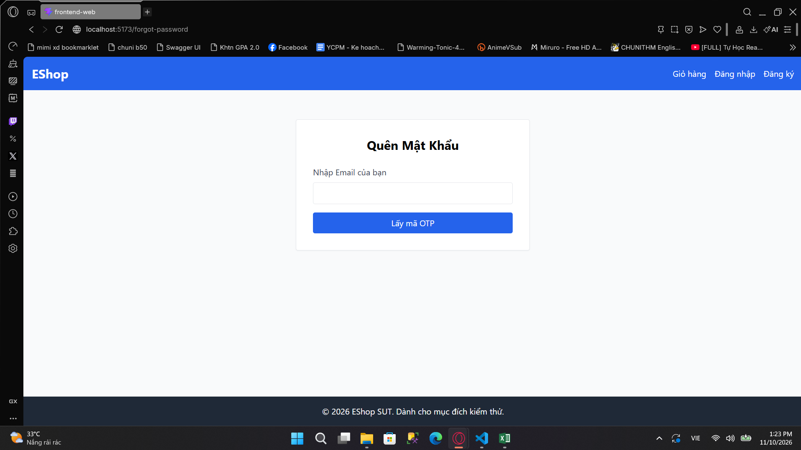

*ER-UI-14*: Màn hình Đăng nhập hiển thị mật khẩu dạng văn bản (không che mật khẩu)
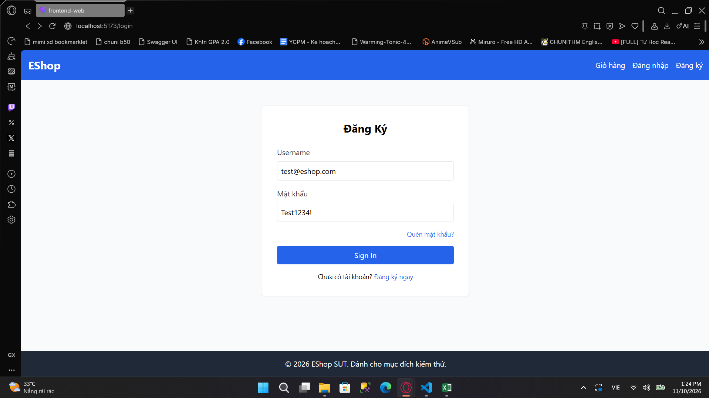

*ER-UI-15*: Nút đăng nhập hiển thị tiếng Anh thay vì tiếng Việt

*ER-FRM-01*: Label không focus vào input tương ứng

*ER-FRM-02*: Email input ở form đăng ký sử dụng kiểu text
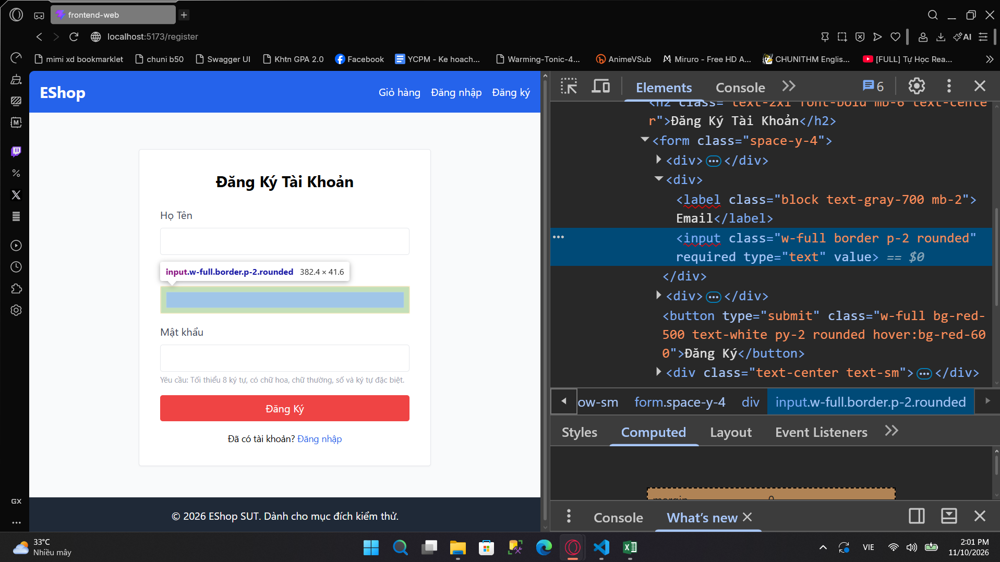

*ER-FRM-04*: Form đăng ký không có field xác nhận mật khẩu

*ER-FRM-05*: Form đăng ký không có đánh dấu field bắt buộc
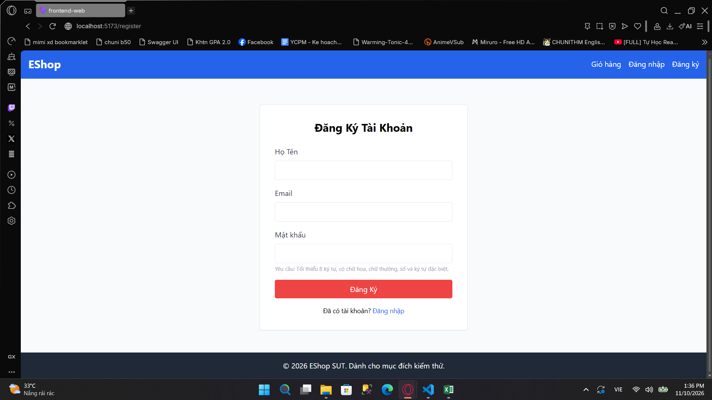

*ER-FRM-10*: Input email ở form đăng nhập dùng kiểu text
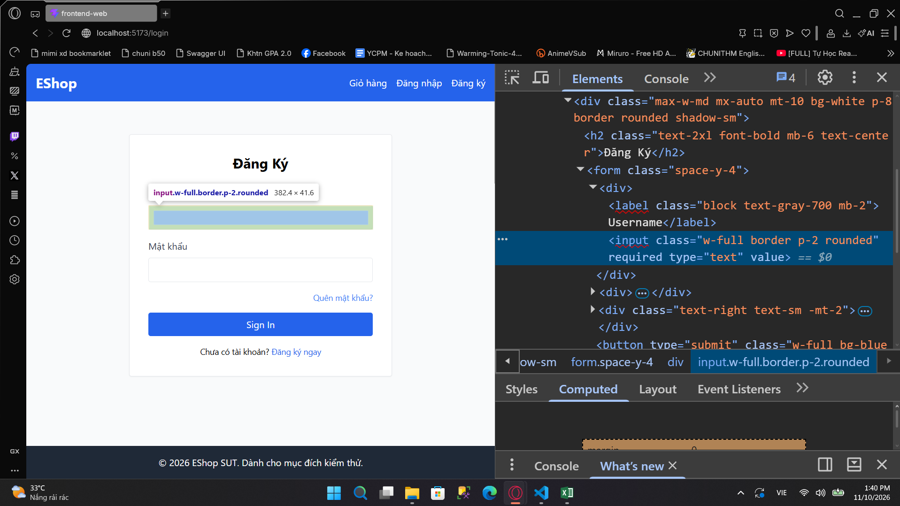

*ER-FRM-14*: Input email ở form quên mật khẩu dùng kiểu text
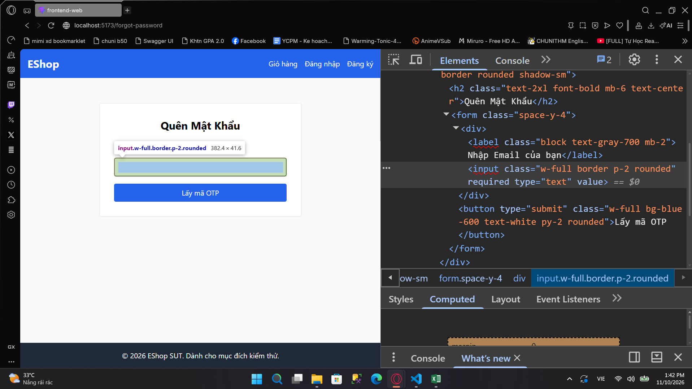

*ER-FRM-18*: Form quên mật khẩu không hiển thị điều kiện mật khẩu mới

*ER-FRM-19*: Form quên mật khẩu không có field xác nhận mật khẩu mới
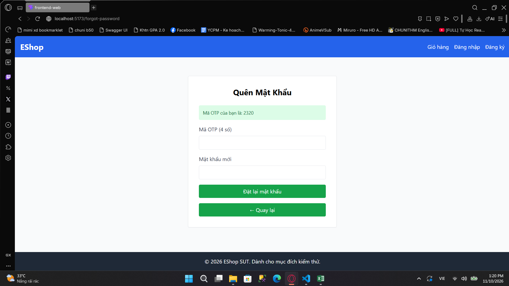

*ER-FRM-21*: Nút đăng nhập được ưu tiên focus sau các thành phần của browser khi focus bằng tab

*ER-FRM-23*: Không có nút ẩn/hiện mật khẩu
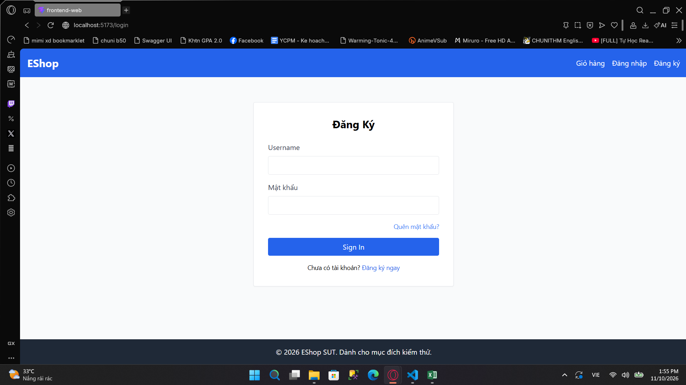
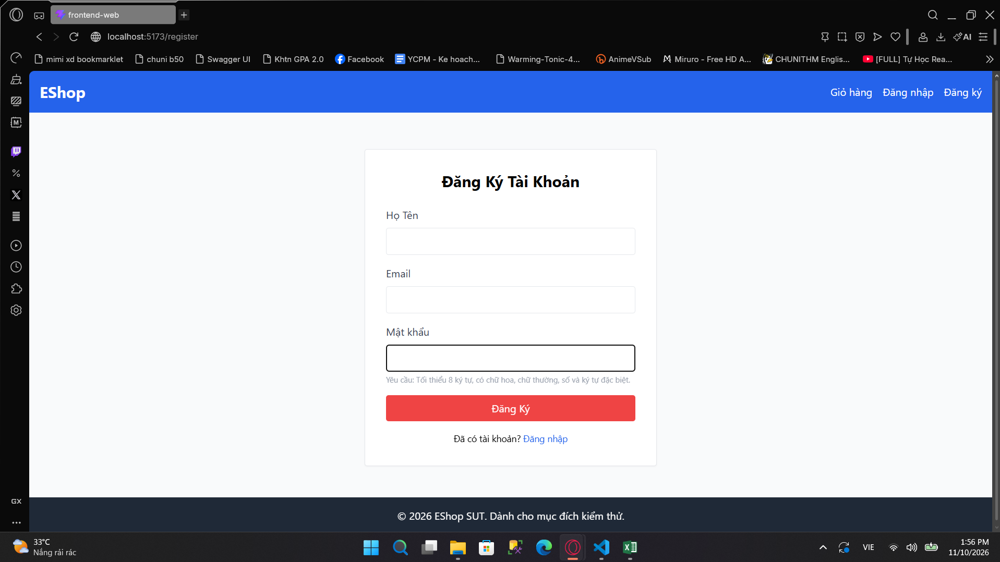
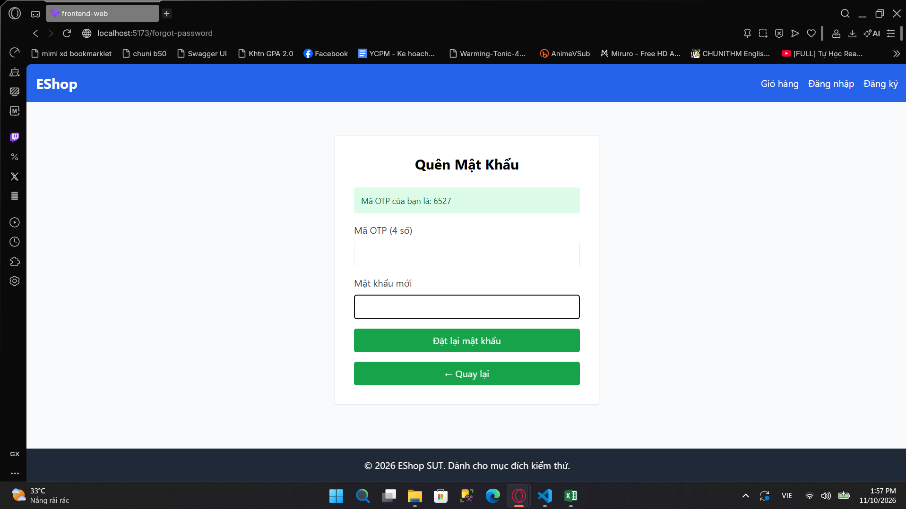

*ER-FRM-24*: Ô OTP nhận các kiểu dữ liệu khác số
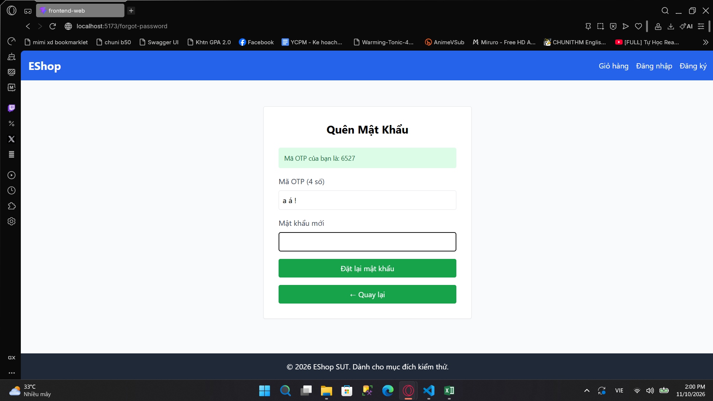

*ER-NAV-04*: Form Quên mật khẩu bước 1 không có nút Quay về đăng nhập

*ER-NAV-12*: Các nút điều hướng được ưu tiên focus sau các thành phần của browser khi focus bằng tab

*ER-NAV-13*: Người dùng sau khi login vẫn điều hướng được đến trang đăng nhập, đăng ký thông qua URL
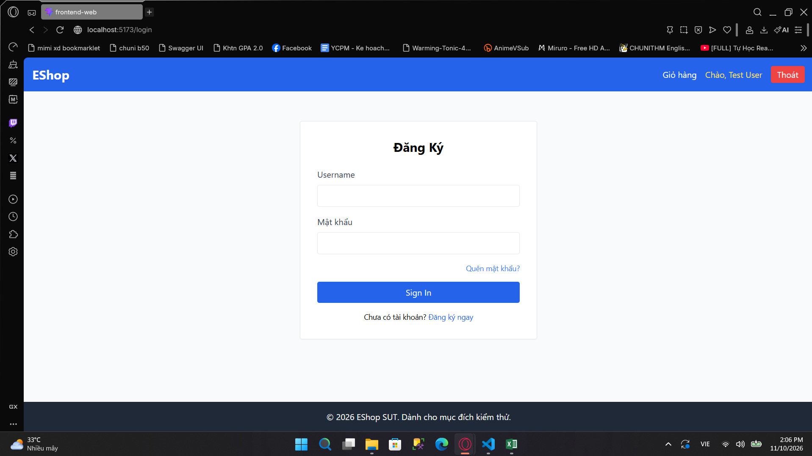

*ER-FB-01*: Không có hiển thị rõ ràng trên UI cho thấy hệ thống đã nhận thao tác

*ER-FB-07*: Khi đăng nhập sai, chỉ hiển thị thông báo đăng nhập thất bại, không thông báo lỗi rõ ràng

*ER-FB-08*: Không hiển thị thời gian khóa khi tài khoản bị tạm khóa

*ER-FB-09*: Khi tài khoản bị khóa, chỉ hiển thị thông báo đăng nhập thất bại, không thông báo lỗi rõ ràng
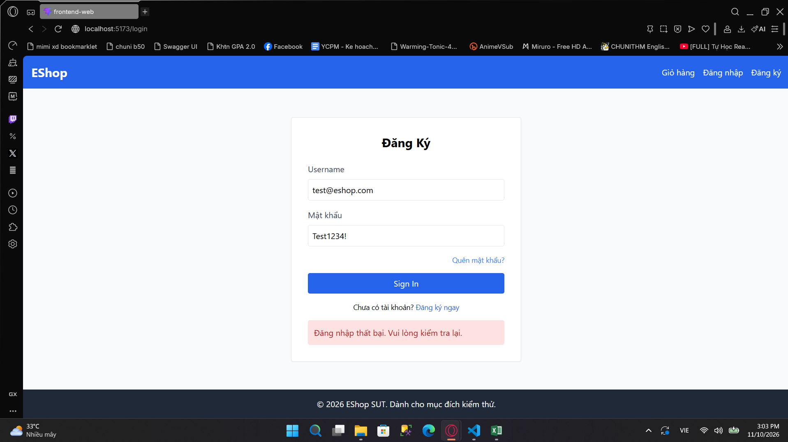