# BÁO CÁO LỖI (BUG REPORT) - ESHOP SUT

## 1. Bảng Tổng Hợp Lỗi
| Bug ID | Feature | Tiêu đề lỗi (Title) | Mức độ (Severity) | Issue Link |
| :--- | :--- | :--- | :--- | :--- |
| BUG-01 | FR-01 (Web) | Ký tự đặc biệt trong mật khẩu đăng ký bao gồm cả khoảng trắng | High | [Issue Link](https://github.com/naaul1/eshop-sut-2627/issues/7) |
| BUG-02 | FR-01 (Web) | Form Đăng ký trên Web thiếu trường "Xác nhận mật khẩu" | High | [Issue Link](https://github.com/naaul1/eshop-sut-2627/issues/6) |
| BUG-03 | FR-01 (Web) | Không kiểm tra định dạng email trong form đăng ký | Medium | [Issue Link](https://github.com/naaul1/eshop-sut-2627/issues/8) |
| BUG-04 | FR-01 (Web) | Nút "Đăng Ký" trên Web sử dụng màu đỏ vi phạm quy chuẩn giao diện | Low | [Issue Link](https://github.com/naaul1/eshop-sut-2627/issues/9) |
| BUG-05 | FR-01 (Backend) | Backend trả về HTTP 500 và lộ lỗi CSDL khi email đăng ký bị trùng | Medium | [Issue Link](https://github.com/naaul1/eshop-sut-2627/issues/10) |
| BUG-06 | FR-07 (Web) | Thêm cùng một sản phẩm vào giỏ không gộp số lượng mà tạo dòng mới | Medium | [Issue Link](https://github.com/naaul1/eshop-sut-2627/issues/11) |
| BUG-07 | FR-07 (Web) | Nút "Xóa" sản phẩm trong giỏ hàng thiếu Dialog xác nhận | Medium | [Issue Link](https://github.com/naaul1/eshop-sut-2627/issues/12) |
| BUG-08 | FR-07 (Web) | Bảng giỏ hàng thiếu nút tăng/giảm số lượng (+/-) cho sản phẩm | Medium | [Issue Link](https://github.com/naaul1/eshop-sut-2627/issues/13) |
| BUG-09 | FR-07 (Web) | Giao diện giỏ hàng trống thiếu hình ảnh minh họa (Illustration) | Low | [Issue Link](https://github.com/naaul1/eshop-sut-2627/issues/14) |
| BUG-10 | FR-07 (Web) | Tiêu đề cột đơn giá trong giỏ hàng hiển thị sai thành "Giá" thay vì "Đơn giá" | Low | [Issue Link](https://github.com/naaul1/eshop-sut-2627/issues/15) |
| BUG-11 | FR-06 / FR-07 (Web) | Nút "Thêm vào giỏ hàng" tại trang chi tiết SP không phản hồi ở lần nhấn đầu tiên | Medium | [Issue Link](https://github.com/naaul1/eshop-sut-2627/issues/16) |
| BUG-12 | FR-15 (Admin) | Cập nhật thông tin một sản phẩm làm đổi tên hàng loạt tất cả sản phẩm | Critical | [Issue Link](https://github.com/naaul1/eshop-sut-2627/issues/17) |
| BUG-13 | FR-15 (Admin) | Hệ thống cho phép thêm/sửa sản phẩm với giá bằng 0 hoặc số âm | High | [Issue Link](https://github.com/naaul1/eshop-sut-2627/issues/18) |
| BUG-14 | FR-15 (Admin) | Form và API sản phẩm không giới hạn độ dài tên sản phẩm (vượt 255 ký tự) | Medium | [Issue Link](https://github.com/naaul1/eshop-sut-2627/issues/19) |
| BUG-15 | FR-01 (Mobile) | Màn hình Đăng ký trên Mobile App thiếu trường "Xác nhận mật khẩu" | High | [Issue Link](https://github.com/naaul1/eshop-sut-2627/issues/20) |
| BUG-16 | FR-01 (Mobile) | Nút "Đăng Ký" trên Mobile App dùng màu đỏ vi phạm quy chuẩn giao diện (FR-21) | Low | [Issue Link](https://github.com/naaul1/eshop-sut-2627/issues/21) |

---

## 2. Chi Tiết Các Lỗi 

### BUG-01: Ký tự đặc biệt trong mật khẩu đăng ký bao gồm cả khoảng trắng
- **Feature:** FR-01 (Account Registration)
- **Các bước tái hiện (Steps to Reproduce):**
  1. Mở trang Đăng ký tài khoản Web (`/register`).
  2. Nhập Họ Tên: `Nguyen Van A`, Email: `testuser@eshop.com`.
  3. Nhập mật khẩu đúng chuẩn bảo mật FR-01 chứa ký tự đặc biệt: `Pass123!`.
  4. Nhấn nút "Đăng Ký".
- **Kết quả thực tế (Actual Result):** Form chặn submit và hiển thị thông báo lỗi: *"Mật khẩu quá yếu! Phải dài tối thiểu 8 ký tự, gồm chữ hoa, chữ thường, số và KÝ TỰ ĐẶC BIỆT.".
- **Kết quả mong đợi (Expected Result):** Mật khẩu `Pass123!` phải được chấp nhận và đăng ký thành công. Mật khẩu chứa khoảng trắng phải bị từ chối.
- **Hình ảnh minh họa / Issue Link:**
  - Issue Link: [Issue Link](https://github.com/naaul1/eshop-sut-2627/issues/7)
  - Screenshot:
    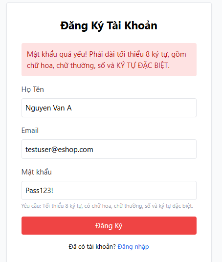

---

### BUG-02: Form Đăng ký trên Web thiếu trường "Xác nhận mật khẩu"
- **Feature:** FR-01 (Account Registration)
- **Các bước tái hiện (Steps to Reproduce):**
  1. Truy cập vào màn hình Đăng ký tài khoản trên Web (`http://localhost:5173/register`).
  2. Quan sát các ô nhập liệu trong form đăng ký.
- **Kết quả thực tế (Actual Result):** Form đăng ký chỉ có 3 trường: "Họ Tên", "Email", và "Mật khẩu". Hoàn toàn không có trường "Xác nhận mật khẩu".
- **Kết quả mong đợi (Expected Result):** Form phải có trường "Xác nhận mật khẩu". Hệ thống bắt buộc người dùng nhập lại mật khẩu và từ chối đăng ký nếu hai mật khẩu không khớp nhau..
- **Hình ảnh minh họa / Issue Link:**
  - Issue Link: [Issue Link](https://github.com/naaul1/eshop-sut-2627/issues/6)
  - Screenshot:
    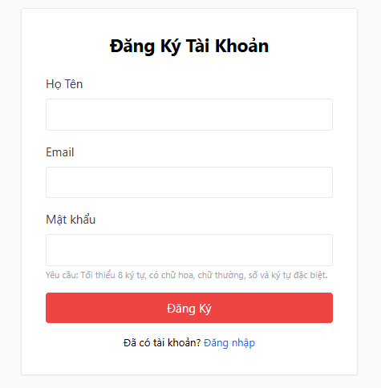

---

### BUG-03: Không kiểm tra định dạng email trong form đăng ký
- **Feature:** FR-01 (Account Registration)
- **Các bước tái hiện (Steps to Reproduce):**
  1. Mở trang Đăng ký Web (`/register`).
  2. Kiểm tra phần tử input Email (Inspect Element).
  3. Nhập định dạng email không hợp lệ như `usereshop.com` (thiếu `@`), `user@` (thiếu domain).
  4. Nhấn nút "Đăng Ký".
- **Kết quả thực tế (Actual Result):** Trình duyệt không kiểm tra định dạng email sai cú pháp ngay tại client.
- **Kết quả mong đợi (Expected Result):** Input Email phải có thuộc tính `type="email"` theo đặc tả FR-02/FR-22 để trình duyệt tự động kiểm tra định dạng email chuẩn trước khi submit..
- **Hình ảnh minh họa / Issue Link:**
  - Issue Link: [Issue Link](https://github.com/naaul1/eshop-sut-2627/issues/8)
  - Screenshot:
    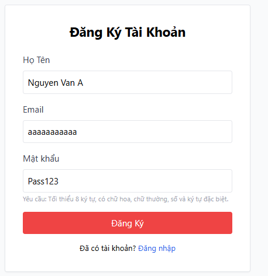

---

### BUG-04: Nút "Đăng Ký" trên Web sử dụng màu đỏ vi phạm quy chuẩn giao diện
- **Feature:** FR-01 (GUI Standards)
- **Các bước tái hiện (Steps to Reproduce):**
  1. Mở trang Đăng ký Web (`/register`).
  2. Quan sát màu sắc nút hành động chính "Đăng Ký".
- **Kết quả thực tế (Actual Result):** Nút đăng ký hiển thị màu đỏ với lớp định kiểu `className="w-full bg-red-500 text-white py-2 rounded hover:bg-red-600"`..
- **Kết quả mong đợi (Expected Result):** Theo tiêu chuẩn giao diện FR-21: *"Nhất quán màu sắc: Các nút hành động tích cực (Submit, Đăng ký, Mua hàng) dùng màu xanh dương. Các nút nguy hiểm/hủy bỏ dùng màu đỏ."*. Nút "Đăng Ký" phải sử dụng màu xanh dương.
- **Hình ảnh minh họa / Issue Link:**
  - Issue Link: [Issue Link](https://github.com/naaul1/eshop-sut-2627/issues/9)
  - Screenshot:
    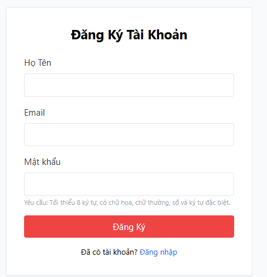

---

### BUG-05: Backend không xử lý email trùng lặp khi đăng ký
- **Feature:** FR-01 (Account Registration)
- **Các bước tái hiện (Steps to Reproduce):**
  1. Gửi request `POST /api/register` với email đã tồn tại trong CSDL (ví dụ: `admin@eshop.com`).
  2. Quan sát mã phản hồi HTTP và dữ liệu JSON trả về.
- **Kết quả thực tế (Actual Result):** Backend trả về HTTP Status `500 Internal Server Error` kèm payload: `{"error": "SQLITE_CONSTRAINT: UNIQUE constraint failed: users.email"}` tại `backend/server.js` dòng 26.
- **Kết quả mong đợi (Expected Result):** Backend cần xử lý bắt lỗi nghiệp vụ, trả về mã lỗi client phù hợp (`400 Bad Request` hoặc `409 Conflict`) kèm thông điệp thân thiện: `"Email đã được sử dụng"`, không làm lộ chi tiết cấu trúc SQL/CSDL theo test case `TC_REG_11`.
- **Hình ảnh minh họa / Issue Link:**
  - Issue Link: [Issue Link](https://github.com/naaul1/eshop-sut-2627/issues/10)
  - Screenshot:
    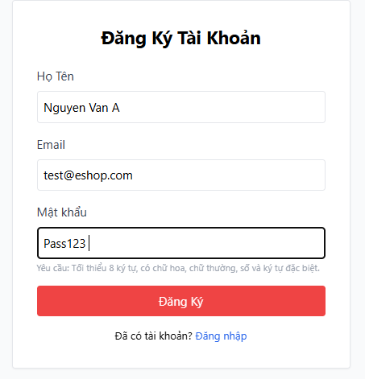

---

### BUG-06: Thêm cùng một sản phẩm vào giỏ không gộp số lượng mà tạo dòng mới
- **Feature:** FR-07 (Shopping Cart)
- **Các bước tái hiện (Steps to Reproduce):**
  1. Đăng nhập người dùng và truy cập trang chủ / chi tiết sản phẩm.
  2. Thêm sản phẩm "iPhone 15 Pro Max" (số lượng = 1) vào giỏ hàng.
  3. Tiếp tục thêm lại sản phẩm "iPhone 15 Pro Max" (số lượng = 1) một lần nữa.
  4. Mở trang Giỏ hàng (`/cart`).
- **Kết quả thực tế (Actual Result):** Giỏ hàng hiển thị 2 dòng riêng biệt cho cùng một sản phẩm "iPhone 15 Pro Max", mỗi dòng có số lượng = 1.
- **Kết quả mong đợi (Expected Result):** Giỏ hàng chỉ hiển thị duy nhất 1 dòng sản phẩm "iPhone 15 Pro Max" với số lượng gộp thành 2 và thành tiền tương ứng.
- **Hình ảnh minh họa / Issue Link:**
  - Issue Link: [Issue Link](https://github.com/naaul1/eshop-sut-2627/issues/11)
  - Screenshot:
    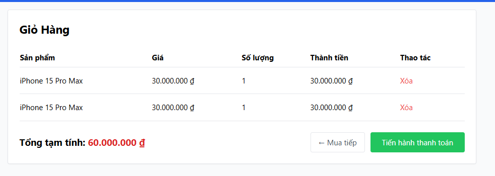

---

### BUG-07: Nút "Xóa" sản phẩm trong giỏ hàng thiếu Dialog xác nhận
- **Feature:** FR-07 (Shopping Cart)
- **Các bước tái hiện (Steps to Reproduce):**
  1. Thêm một sản phẩm vào giỏ hàng và mở trang Giỏ hàng (`/cart`).
  2. Nhấn nút "Xóa" tại dòng sản phẩm.
- **Kết quả thực tế (Actual Result):** Sản phẩm bị xóa ngay lập tức khỏi giỏ hàng mà không hiển thị bất kỳ hộp thoại xác nhận nào..
- **Kết quả mong đợi (Expected Result):** Theo đặc tả FR-07: *"Nút Xóa sản phẩm phải có dialog xác nhận trước khi thực hiện."*. Hệ thống phải bật Dialog/Modal hỏi người dùng xác nhận: Nếu bấm "OK" mới xóa sản phẩm, nếu bấm "Cancel" thì giữ nguyên sản phẩm.
- **Hình ảnh minh họa / Issue Link:**
  - Issue Link: [Issue Link](https://github.com/naaul1/eshop-sut-2627/issues/12)
  - Screenshot:
    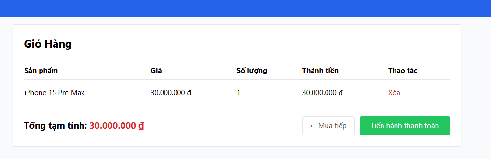

---

### BUG-08: Bảng giỏ hàng thiếu nút tăng/giảm số lượng (+/-) cho sản phẩm
- **Feature:** FR-07 (Shopping Cart)
- **Các bước tái hiện (Steps to Reproduce):**
  1. Thêm sản phẩm vào giỏ và truy cập trang Giỏ hàng (`/cart`).
  2. Quan sát cột "Số lượng" trong bảng hiển thị giỏ hàng.
- **Kết quả thực tế (Actual Result):** Cột "Số lượng" chỉ hiển thị chuỗi text tĩnh không có nút bấm hay ô input nào để điều chỉnh số lượng.
- **Kết quả mong đợi (Expected Result):** Cột số lượng phải có các nút điều khiển `+` và `-` để người dùng tăng/giảm số lượng sản phẩm trực tiếp trong giỏ.
- **Hình ảnh minh họa / Issue Link:**
  - Issue Link: [Issue Link](https://github.com/naaul1/eshop-sut-2627/issues/13)
  - Screenshot:
    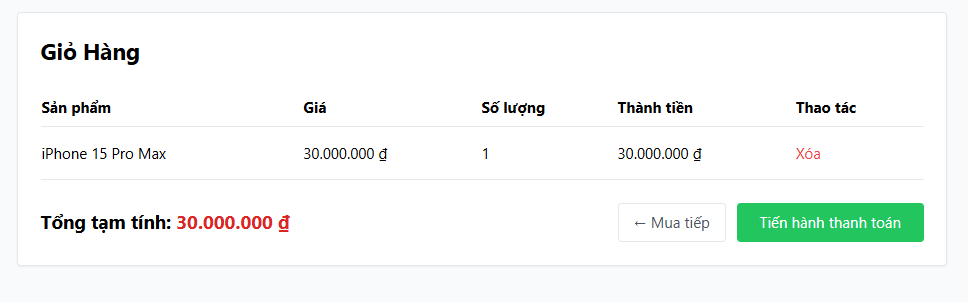

---

### BUG-09: Giao diện giỏ hàng trống thiếu hình ảnh minh họa (Illustration)
- **Feature:** FR-07 (Shopping Cart)
- **Các bước tái hiện (Steps to Reproduce):**
  1. Đăng nhập và truy cập trang Giỏ hàng (`/cart`) khi chưa thêm sản phẩm nào (giỏ hàng rỗng).
  2. Quan sát giao diện màn hình.
- **Kết quả thực tế (Actual Result):** Trang chỉ render một tiêu đề chữ: Giỏ hàng của bạn đang trống và liên kết quay lại. Hoàn toàn không có hình ảnh minh họa minh bạch trạng thái giỏ trống.
- **Kết quả mong đợi (Expected Result):** Theo đặc tả FR-07: *"Giỏ hàng trống phải có hình minh họa và thông báo rõ ràng."* .
- **Hình ảnh minh họa / Issue Link:**
  - Issue Link: [Issue Link](https://github.com/naaul1/eshop-sut-2627/issues/14)
  - Screenshot:
    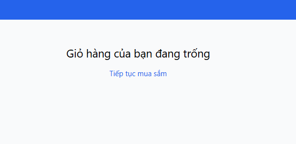

---

### BUG-10: Tiêu đề cột đơn giá trong giỏ hàng hiển thị sai thành "Giá" thay vì "Đơn giá"
- **Feature:** FR-07 (Shopping Cart)
- **Các bước tái hiện (Steps to Reproduce):**
  1. Thêm sản phẩm vào giỏ hàng và mở trang `/cart`.
  2. Quan sát hàng tiêu đề bảng (`<thead>`) của giỏ hàng.
- **Kết quả thực tế (Actual Result):** Cột thứ hai hiển thị tiêu đề là Giá.
- **Kết quả mong đợi (Expected Result):** Tiêu đề cột phải là `"Đơn giá"` theo đúng văn bản đặc tả FR-07: *"Hiển thị danh sách sản phẩm với các cột: Sản phẩm, Đơn giá, Số lượng, Thành tiền, Thao tác."*.
- **Hình ảnh minh họa / Issue Link:**
  - Issue Link: [Issue Link](https://github.com/naaul1/eshop-sut-2627/issues/15)
  - Screenshot:
    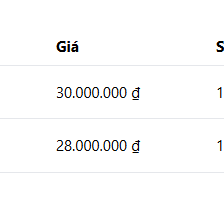

---

### BUG-11: Nút "Thêm vào giỏ hàng" tại trang chi tiết SP không phản hồi ở lần nhấn đầu tiên
- **Feature:** FR-06 / FR-07 (Product Detail & Cart)
- **Các bước tái hiện (Steps to Reproduce):**
  1. Truy cập trang chi tiết sản phẩm bất kỳ (ví dụ: `/products/1`).
  2. Nhấp chuột lần thứ nhất vào nút "Thêm vào giỏ hàng".
  3. Mở giỏ hàng kiểm tra.
- **Kết quả thực tế (Actual Result):** Ở lần nhấn đầu tiên, không có sản phẩm nào được thêm vào giỏ hàng và không có phản hồi trực quan. Người dùng phải bấm lần thứ hai thì sản phẩm mới được thêm.
- **Kết quả mong đợi (Expected Result):** Nút "Thêm vào giỏ hàng" phải xử lý thêm sản phẩm ngay ở lần bấm đầu tiên và hiển thị phản hồi trực quan.
- **Hình ảnh minh họa / Issue Link:**
  - Issue Link: [Issue Link](https://github.com/naaul1/eshop-sut-2627/issues/16)
  - Screenshot:
    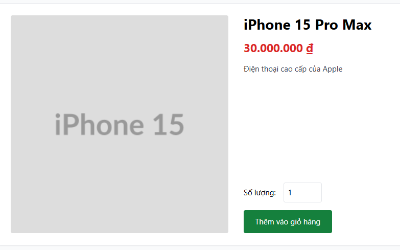

---

### BUG-12: Cập nhật thông tin một sản phẩm làm đổi tên hàng loạt tất cả sản phẩm 
- **Feature:** FR-15 (Product Management)
- **Các bước tái hiện (Steps to Reproduce):**
  1. Đăng nhập vào trang Quản trị Admin (`http://localhost:5174`).
  2. Vào tab "Sản phẩm", nhấn "Sửa" tại một sản phẩm bất kỳ (ví dụ: sản phẩm ID 1 "iPhone 15 Pro Max").
  3. Đổi tên sản phẩm thành "iPhone 15 Pro Max Edited" và nhấn "Lưu sản phẩm".
  4. Quan sát danh sách sản phẩm hiển thị trên bảng.
- **Kết quả thực tế (Actual Result):** Toàn bộ tất cả sản phẩm trong bảng quản lý đều bị đổi tên thành "iPhone 15 Pro Max Edited".
- **Kết quả mong đợi (Expected Result):** Theo đặc tả FR-15: *"Khi Sửa một sản phẩm, chỉ sản phẩm đó bị thay đổi — các sản phẩm khác giữ nguyên."*.
- **Hình ảnh minh họa / Issue Link:**
  - Issue Link: [Issue Link](https://github.com/naaul1/eshop-sut-2627/issues/17)
  - Screenshot:
    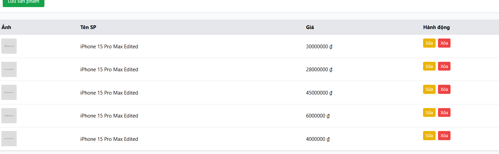

---

### BUG-13: Hệ thống cho phép thêm/sửa sản phẩm với giá bằng 0 hoặc số âm
- **Feature:** FR-15 (Product Management)
- **Các bước tái hiện (Steps to Reproduce):**
  1. Truy cập tab "Sản phẩm" trên trang Quản trị Admin.
  2. Nhập tên sản phẩm: "Sản phẩm lỗi giá", giá: `0` (hoặc `-100000`).
  3. Nhấn nút "Lưu sản phẩm" (hoặc gửi request `POST /api/products` với `price: 0`).
- **Kết quả thực tế (Actual Result):** Sản phẩm có giá 0 ₫ hoặc số âm được lưu thành công vào cơ sở dữ liệu.
- **Kết quả mong đợi (Expected Result):** Hệ thống phải từ chối thêm sản phẩm và báo lỗi yêu cầu giá phải là số dương lớn hơn 0 theo đặc tả FR-15: *"Giá: bắt buộc, phải là số dương (> 0)"*.
- **Hình ảnh minh họa / Issue Link:**
  - Issue Link: [Issue Link](https://github.com/naaul1/eshop-sut-2627/issues/18)
  - Screenshot:
    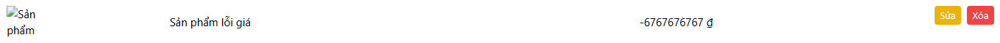

---

### BUG-14: Form và API sản phẩm không giới hạn độ dài tên sản phẩm (vượt 255 ký tự)
- **Feature:** FR-15 (Product Management)
- **Các bước tái hiện (Steps to Reproduce):**
  1. Mở form thêm sản phẩm trên trang Web Admin.
  2. Nhập tên sản phẩm dài 256 ký tự (ví dụ chuỗi gồm 256 ký tự chữ `'A'`).
  3. Nhập giá hợp lệ và nhấn "Lưu sản phẩm".
- **Kết quả thực tế (Actual Result):** Sản phẩm được thêm thành công với tên 256 ký tự vào CSDL.
- **Kết quả mong đợi (Expected Result):** Hệ thống phải chặn hoặc cắt chuỗi ở độ dài 255 ký tự theo quy định FR-15: *"Tên sản phẩm: bắt buộc, tối đa 255 ký tự"*.
- **Hình ảnh minh họa / Issue Link:**
  - Issue Link: [Issue Link](https://github.com/naaul1/eshop-sut-2627/issues/19)
  - Screenshot:
    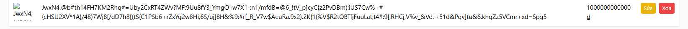

---

### BUG-15: Màn hình Đăng ký trên Mobile App thiếu trường "Xác nhận mật khẩu"
- **Feature:** FR-01 (Mobile App Registration)
- **Các bước tái hiện (Steps to Reproduce):**
  1. Mở ứng dụng Mobile (`frontend-mobile`).
  2. Nhấn "Đăng ký" để vào màn hình Đăng ký tài khoản.
  3. Quan sát các ô nhập liệu có trên màn hình.
- **Kết quả thực tế (Actual Result):** Giao diện chỉ có 3 ô TextInput: "Họ Tên", "Email", "Mật khẩu". Trường "Xác nhận mật khẩu" hoàn toàn không xuất hiện trên ứng dụng Mobile.
- **Kết quả mong đợi (Expected Result):** Màn hình Đăng ký Mobile phải có trường "Xác nhận mật khẩu". Ứng dụng phải kiểm tra hai mật khẩu có khớp nhau hay không trước khi gửi dữ liệu lên server..
- **Hình ảnh minh họa / Issue Link:**
  - Issue Link: [Issue Link](https://github.com/naaul1/eshop-sut-2627/issues/20)
  - Screenshot:
    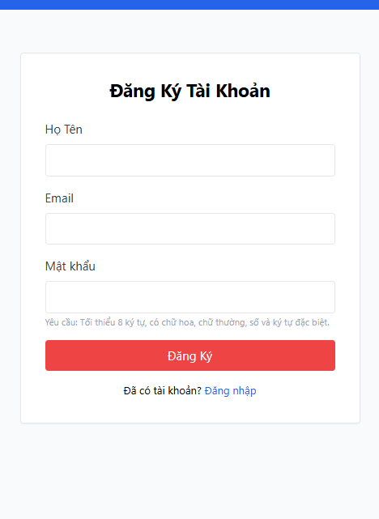

---

### BUG-16: Nút "Đăng Ký" trên Mobile App dùng màu đỏ vi phạm quy chuẩn giao diện (FR-21)
- **Feature:** FR-01 (GUI Standards)
- **Các bước tái hiện (Steps to Reproduce):**
  1. Mở màn hình Đăng ký trên ứng dụng Mobile.
  2. Quan sát nút bấm "Đăng Ký".
- **Kết quả thực tế (Actual Result):** Nút đăng ký hiển thị màu đỏ rực rỡ.
- **Kết quả mong đợi (Expected Result):** Theo tiêu chuẩn thiết kế FR-21: Các nút hành động chính, tích cực (Submit, Đăng ký) phải sử dụng màu xanh dương (`primary blue`), màu đỏ chỉ dùng cho các thao tác cảnh báo nguy hiểm hoặc hủy bỏ.
- **Hình ảnh minh họa / Issue Link:**
  - Issue Link: [Issue Link](https://github.com/naaul1/eshop-sut-2627/issues/21)
  - Screenshot:
    
